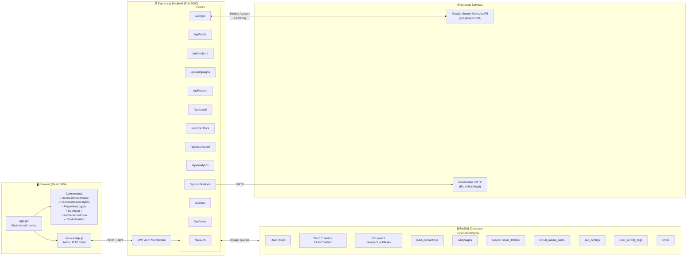
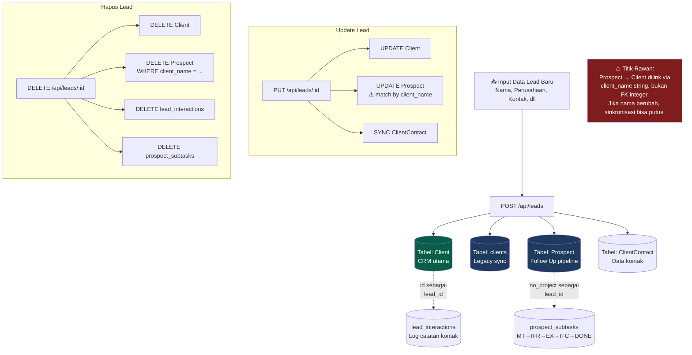

# Flowchart — Infimech ERP Marketing

Dokumen ini berisi 3 flowchart:
1. **Alur Pengguna (User Flow)** — perjalanan user dari login sampai logout
2. **Arsitektur Sistem** — gambaran lapisan Frontend ↔ Backend ↔ Database
3. **Alur Data CRM** — sinkronisasi data lead antar tabel

---

## 1. User Flow Utama

```mermaid
flowchart TD
    A([Buka URL]) --> B{Tipe URL?}

    B -->|/share/assets/:id| PUB1[🔓 Public Asset Page\nTanpa Login]
    PUB1 --> PUB1A[Tampil info file]
    PUB1A --> PUB1B[Klik Unduh?\nPOST /api/assets/public/:id/download]

    B -->|?share_token=xxx| PUB2[🔓 Client Folder Portal\nTanpa Login]
    PUB2 --> PUB2A[Tampil semua file folder]
    PUB2A --> PUB2B[Filter / Search / Unduh langsung]

    B -->|URL biasa| AUTH{Token di\nlocalStorage?}

    AUTH -->|Tidak| LOGIN[🔐 Halaman Login]
    LOGIN --> LOGIN1[Input email + password]
    LOGIN1 --> LOGIN2[POST /api/auth/login]
    LOGIN2 -->|Gagal| LOGIN_ERR[Tampil error\nKembali ke Login]
    LOGIN2 -->|Berhasil| SAVE_TOKEN[Simpan JWT + data user]

    AUTH -->|Ada| VERIFY[GET /api/auth/profile]
    SAVE_TOKEN --> VERIFY
    VERIFY -->|Token kedaluwarsa| LOGIN
    VERIFY -->|Valid| INTRO[✨ Intro Animation\n1x per session]

    INTRO --> APP[🏠 App Shell Dimuat]
    APP --> INIT[Inisialisasi:\n• GET /api/dashboard\n• GET /api/notifications/deadlines\n• PageViewLogger aktif]

    INIT --> SIDEBAR{Pilih Menu\ndi Sidebar}

    %% Dashboard
    SIDEBAR -->|Dashboard| DASH[📊 Dashboard\nAuto-refresh 6 detik]
    DASH --> DASH1[KPI: Active Leads, Won,\nLoss, Revenue]
    DASH --> DASH2[Bar Chart Tren 3m/6m/12m]
    DASH --> DASH3[Donut Chart Stage]
    DASH --> DASH4[Follow Up Terdekat]
    DASH --> DASH5[SEO Metrics Overview]

    %% Operator CRM
    SIDEBAR -->|Operator CRM| CRM{Tab CRM}

    CRM -->|Lead Management| LEADS[📋 Tabel Lead\nGET /api/leads]
    LEADS --> LEADS_ACT{Aksi}
    LEADS_ACT -->|Klik baris| LEAD_DETAIL[Detail Lead\nGET /api/leads/:id]
    LEAD_DETAIL --> LEAD_EDIT[Edit → PUT /api/leads/:id]
    LEAD_DETAIL --> LEAD_DEL[Hapus → DELETE /api/leads/:id]
    LEAD_DETAIL --> LEAD_NOTE[Tambah Catatan\nPOST /api/leads/:id/interactions]
    LEAD_DETAIL --> LEAD_CONTACT[Tambah Kontak\nPOST /api/leads/:id/contacts]
    LEADS_ACT -->|+ New Client| NEW_LEAD[POST /api/leads\nAuto-sync ke 3 tabel]
    LEADS_ACT -->|+ Bulk Import CSV| BULK[POST /api/leads/bulk\nBatch insert]

    CRM -->|Segmentasi| SEG[📦 6 Kartu Segmen\nGET /api/leads/segments]
    SEG --> SEG1[High Score / Enterprise\nDigital Ads / Dormant\nPT / Proposal]

    CRM -->|Role & Operator| OPS[👥 Tabel Operator\nGET /api/operators]
    OPS --> OPS_CRUD[CRUD Operator\nAdmin+ Only]

    %% Digital Marketing
    SIDEBAR -->|Digital Marketing| DM{Tab Digital\nMarketing}

    DM -->|Konten & Aset| ASSETS[🗂️ Asset Library\nGET /api/assets]
    ASSETS --> ASSETS_ACT{Aksi}
    ASSETS_ACT -->|Preview| PREVIEW[Modal preview\nPDF / Gambar / Video]
    ASSETS_ACT -->|Unduh| DOWNLOAD[POST /api/assets/:id/download\nIncrement counter]
    ASSETS_ACT -->|Bagikan| SHARE_LINK[Salin link\n/share/assets/:id]
    ASSETS_ACT -->|Upload baru| UPLOAD[POST /api/assets\nSimpan sebagai Base64]
    ASSETS_ACT -->|Update versi| VER[PUT /api/assets/:id\nAuto-increment version]

    DM -->|Folder Library| FOLDERS[📁 Folder Grid\nGET /api/assets/folders]
    FOLDERS --> FOLDER_ACT{Aksi}
    FOLDER_ACT -->|Buka folder| FOLDER_FILES[Lihat file dalam folder]
    FOLDER_ACT -->|Bagikan ke klien| FOLDER_SHARE[Salin link portal klien\n?share_token=xxx]
    FOLDER_ACT -->|Upload ke folder| FOLDER_UPLOAD[POST /api/assets/folders/:id/files]

    DM -->|GSC Performance| GSC[📈 GSC Dashboard\nGET /api/gsc/sites]
    GSC --> GSC_SELECT[Pilih Site / Range / Search Type]
    GSC_SELECT --> GSC_DATA[GET /api/gsc/analytics\n→ Google Search Console API]
    GSC_DATA --> GSC_CHART[4 KPI Cards +\nLineChart Klik & Impressi]

    %% Follow Up
    SIDEBAR -->|Follow Up| FU{Tab Follow Up}

    FU -->|Pipeline Kanban| KANBAN[🔲 Kanban Board\nGET /api/projects]
    KANBAN --> KANBAN_COL[6 Kolom:\nLead → Proposal → Hold\nLose → Won → Done]
    KANBAN --> KANBAN_CARD[Klik Card → Detail\nGET /api/projects/:id]
    KANBAN_CARD --> KANBAN_EDIT[Edit → PUT /api/projects/:id]
    KANBAN_CARD --> KANBAN_NOTE[Riwayat Kontak\nPOST /api/leads/:id/interactions]
    KANBAN_CARD --> SUBTASK[Subtasks Panel\nGET /api/leads/:id/subtasks]
    SUBTASK --> SUBTASK_FLOW[Status: MT→IFR→EX→IFC→DONE\nPUT /api/leads/subtasks/:id]

    FU -->|Social Media| SOCIAL[📱 Social Media Calendar\nGET /api/social]
    SOCIAL --> SOCIAL_PLAT[Platform:\nIG / FB / TikTok\nLinkedIn / Twitter / YouTube]
    SOCIAL --> SOCIAL_SCHED[Schedule Post\nPOST /api/social]
    SOCIAL --> SOCIAL_EDIT[Edit/Hapus\nPUT/DELETE /api/social/:id]

    %% Catatan
    SIDEBAR -->|Catatan| NOTES[📝 Notes Grid\nGET /api/notes]
    NOTES --> NOTES_FILTER[Filter: Masalah / Temuan\nIde / Lainnya]
    NOTES --> NOTES_CRUD[Tambah / Edit / Hapus\nPOST/PUT/DELETE /api/notes]
    NOTES_CRUD --> NOTES_RULE[Catatan: hanya pemilik\natau Admin+ bisa edit/hapus]

    %% Logout
    SIDEBAR -->|Logout| LOGOUT[🚪 Hapus Token\nKembali ke Login]

    %% Style
    style A fill:#1e293b,color:#fff
    style PUB1 fill:#0f4c75,color:#fff
    style PUB2 fill:#0f4c75,color:#fff
    style LOGIN fill:#7f1d1d,color:#fff
    style APP fill:#064e3b,color:#fff
    style DASH fill:#1e3a5f,color:#fff
    style KANBAN fill:#1e3a5f,color:#fff
    style GSC fill:#1e3a5f,color:#fff
    style LOGOUT fill:#374151,color:#fff
```



---

## 2. Arsitektur Sistem



---

## 3. Alur Data CRM — Sinkronisasi 3 Tabel



---

## Cara Buka Flowchart

**Option 1 — VS Code:**
Install ekstensi **Markdown Preview Mermaid Support**, lalu buka file ini dan klik preview (`Ctrl+Shift+V`).

**Option 2 — Online:**
Copy blok kode di dalam ` ```mermaid ` lalu paste ke [mermaid.live](https://mermaid.live).

**Option 3 — draw.io / Notion:**
Notion mendukung blok Mermaid secara native. draw.io bisa import via Extras > Edit Diagram.
